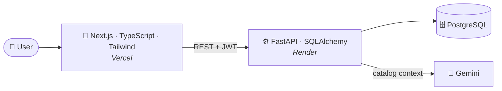

<!-- ===================== HEADER ===================== -->


<p align="center">
  <a href="https://git.io/typing-svg">
    
  </a>
</p>

<p align="center">
  
  
  
</p>

<p align="center">
  <a href="https://www.linkedin.com/in/omar-elmallah-a57266406"></a>
  <a href="mailto:elmallahomar24@gmail.com"></a>
  <a href="https://electro-frontend-khaki.vercel.app"></a>
</p>


<!-- ===================== ABOUT ===================== -->
## 👨‍💻 About Me

<table>
  <tr>
    <td width="60%" valign="top">

```python
class Omar:
    role      = ["Full-Stack Developer", "AI Student"]
    location  = "Cairo, Egypt"
    stack     = ["Next.js", "React", "FastAPI", "PostgreSQL"]
    building  = "Electro: e-commerce + AI shopping assistant"
    next_up   = "Product recommendation model on order data"
    learning  = ["MLOps", "Model deployment", "Redis"]
    open_to   = "Remote internships"
    ask_me    = ["Python", "JS/TS", "React", "Next.js", "SQL", "REST APIs"]
```

  </td>
    <td width="40%" valign="top">

🚀 **Full-Stack Developer** who ships real, deployed products

🧠 **AI student** focused on putting models inside production apps

🤝 **Let's collaborate on:** AI-powered web apps & production-ready interfaces

⚡ **Fun fact:** I fixed a checkout race condition with a single atomic SQL statement

  </td>
  </tr>
</table>


<!-- ===================== FEATURED PROJECT ===================== -->
## ⚡ Featured Project: Electro

> **A deployed electronics store with a Gemini-powered assistant that answers only from the store's real catalog.**

| 🛍️ Customers | 🛠️ Admins | 🤖 AI Assistant |
|:--|:--|:--|
| Browse, search, manage cart and checkout | Manage products, users and orders | Grounded in live inventory, API key kept server-side |

**Highlights**

- 🛡️ **Race-condition-safe checkout** using one atomic SQL `UPDATE ... WHERE stock > 0`
- 🔐 **JWT auth** (1-hour expiry), bcrypt hashing, admin checks re-verified in the database
- 🤖 **AI shopping assistant** that never invents products
- 🌗 Dark/light themes, instant search (`Ctrl/⌘ + K`), fully responsive

### 🏗️ Architecture



<p align="center">
  
</p>

<p align="center">
  <a href="https://electro-frontend-khaki.vercel.app"></a>
  <a href="https://github.com/Omar404X0/Electro-Backend"></a>
  <a href="https://github.com/Omar404X0/Electro-Frontend"></a>
  <a href="https://electro-backend-2dx5.onrender.com/docs"></a>
</p>

<p align="center"><sub>⏳ The API runs on a free tier, so the first request can take up to a minute to wake up.</sub></p>


<!-- ===================== ROADMAP ===================== -->
## 🧭 Roadmap

| Goal | Status |
|:--|:--|
| Electro: full-stack store + AI assistant |  |
| Product recommendation model (order data) |  |
| Docker |  |
| Database optimization with SQLAlchemy |  |
| Redis (caching & fast data access) |  |
| MLOps & model deployment |  |


<!-- ===================== TECH STACK ===================== -->
## 💻 Tech Stack

<h3 align="center">🎨 Frontend</h3>
<p align="center">
  
</p>

<h3 align="center">⚙️ Backend & APIs</h3>
<p align="center">
  <br/>
  
  
  
  
</p>

<h3 align="center">🗄️ Databases</h3>
<p align="center">
  
</p>

<h3 align="center">🧠 Data, ML & AI</h3>
<p align="center">
  <br/>
  
</p>

<h3 align="center">🧰 Languages, DevOps & Tools</h3>
<p align="center">
  <br/>
  
</p>


<!-- ===================== STATS ===================== -->
## 📊 GitHub Stats

<p align="center">
  
  
</p>

<p align="center">
  
</p>

<p align="center">
  
</p>


<!-- ===================== SNAKE ===================== -->
## 🐍 Contribution Snake

<p align="center">
  <picture>
    <source media="(prefers-color-scheme: dark)" srcset="https://raw.githubusercontent.com/Omar404X0/Omar404X0/output/github-snake-dark.svg" />
    <source media="(prefers-color-scheme: light)" srcset="https://raw.githubusercontent.com/Omar404X0/Omar404X0/output/github-snake.svg" />
    
  </picture>
</p>


<!-- ===================== TROPHIES ===================== -->
## 🏆 GitHub Trophies

<p align="center">
  
</p>

<!-- ===================== CONTACT ===================== -->
## 📫 Let's Build Something

<p align="center">
  <b>Open to remote internships and AI-powered web app collaborations.</b><br/><br/>
  <a href="mailto:elmallahomar24@gmail.com"></a>
  <a href="https://www.linkedin.com/in/omar-elmallah-a57266406"></a>
</p>

<!-- ===================== FOOTER ===================== -->

