<!-- البانر الرئيسي في الأعلى -->

  

<!-- الفاصل -->

<!-- مهارات المكدس (Stack) بحجم كبير وواضح -->

  

<!-- مسار التعلم أو Roadmap -->

  

<!-- المشروع المميز (Electro) -->

  

<!-- شاشة التيرمينال -->

  

<!-- قسم التواصل (Contact Section) بحجم كبير وواضح -->

  

<!-- الفاصل قبل النهاية -->

<!-- الفوتر في النهاية -->

