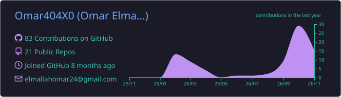
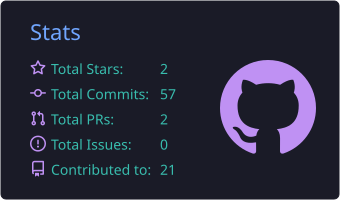
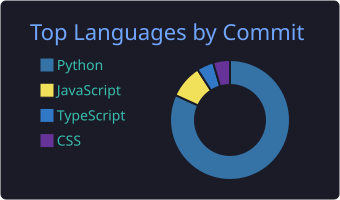
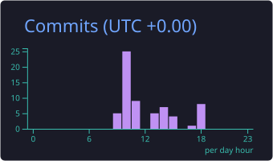
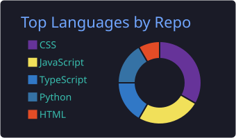

<!-- ===================== HEADER ===================== -->

  

  
  
  

<!-- ===================== ABOUT ===================== -->
<h2 align="center">👨‍💻 About Me</h2>

  

<table align="center">
  <tr>
    <td>🚀 <b>Full-Stack Developer</b> who ships real, deployed products</td>
    <td>🧠 <b>AI student</b> putting models inside production apps</td>
  </tr>
  <tr>
    <td>🤝 <b>Let's collaborate on:</b> AI-powered web apps &amp; production-ready interfaces</td>
    <td>⚡ <b>Fun fact:</b> I fixed a checkout race condition with a single atomic SQL statement</td>
  </tr>
</table>

<!-- ===================== FEATURED PROJECT ===================== -->
<h2 align="center">🚀 Featured Project</h2>

  

  
  
  
  

⏳ The API runs on a free tier, so the first request can take up to a minute to wake up.

<!-- ===================== STACK ===================== -->
<h2 align="center">💻 Tech Stack</h2>

  

<!-- ===================== ROADMAP ===================== -->
<h2 align="center">🧭 Roadmap</h2>

  

<!-- ===================== STATS + SNAKE (unchanged) ===================== -->
<h2 align="center">📊 GitHub Stats</h2>

  

  

  
  

  
  

<!-- ===================== SNAKE ===================== -->
<h2 align="center">🐍 Contribution Snake</h2>

  <picture>
    <source media="(prefers-color-scheme: dark)" srcset="https://raw.githubusercontent.com/Omar404X0/Omar404X0/output/github-snake-dark.svg" />
    <source media="(prefers-color-scheme: light)" srcset="https://raw.githubusercontent.com/Omar404X0/Omar404X0/output/github-snake.svg" />
    
  </picture>

<!-- ===================== CONTACT ===================== -->
<h2 align="center">📫 Get in Touch</h2>

<b>Open to remote internships and AI-powered web app collaborations.</b>

  
  

<!-- ===================== FOOTER ===================== -->

